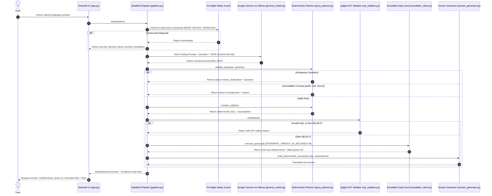
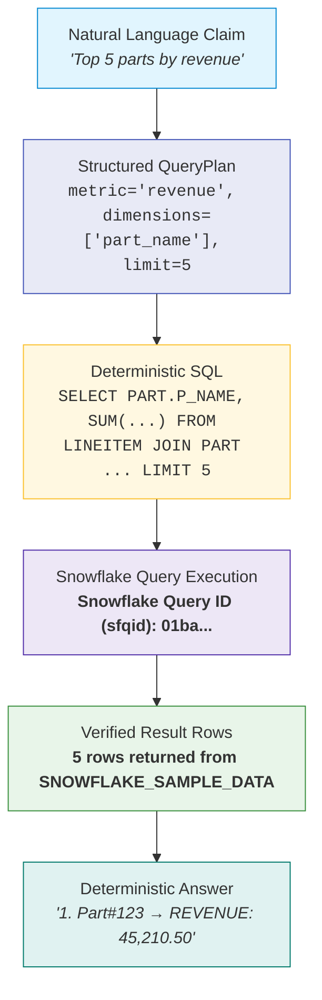

# DataMind Architecture & Traceability

"DataMind – Talk to Your Data" is a zero-hallucination semantic data assistant designed for ZeroDay OSS Hacktoberfest 2026 (Problem Statement 1).

The core tenet is strict separation between probabilistic reasoning (language models) and deterministic data operations (SQL compilation and real database execution). Numbers come **only** from Snowflake query result rows, never from language model generations.

---

## 1. End-to-End Pipeline Workflow

---

## 2. The Claim -> SQL -> Rows Traceability Chain

Every insight displayed to the user follows a verifiable audit trail:

### Traceability Guarantees:
1. **Provenance Dataclass (`Evidence`)**:
   Contains `question`, `plan_json`, `executed_sql`, `snowflake_query_id`, `row_count`, `elapsed_time_seconds`, `result_df`, `assumptions`, and `model_name`.
2. **Zero Model Number Generation**:
   The model never formats, computes, or fabricates numbers. All aggregations are performed inside Snowflake's analytical engine.
3. **Double Verification**:
   If an optional natural language explanation is requested from Gemma, the `AnswerGenerator.verify_numbers_against_df()` checks every extracted number against the returned dataframe. If any number fails to match, the LLM text is discarded and only deterministic rows are shown.

---

## 3. Defense-in-Depth Security Architecture

DataMind enforces safety across five distinct layers:

| Layer | Component | Mechanism |
|---|---|---|
| **1. Pre-flight Guard** | `pipeline.py` | Regex pattern matching rejecting DDL/DML intentions before any LLM or DB call. |
| **2. Catalog Isolation** | `gemma_model.py` | Prompt receives **only** the semantic catalog (metrics, dimensions, unavailable concepts). No table names, raw DDL, or database connection strings are ever sent to the model. |
| **3. Deterministic Compilation** | `query_planner.py` | Code generates SQL using predefined expressions from `config/datasets.yaml` and safe graph-based joins. Parameterized literals and string-escaped filters prevent injection. |
| **4. AST SQL Validator** | `sql_validator.py` | `sqlglot` parses Snowflake AST. Strictly requires: exactly one statement; must be a `SELECT`; forbids all DDL/DML; verifies every table and column against catalog; enforces mandatory `LIMIT <= max_rows`. |
| **5. Database Hardening** | Snowflake Role | Snowflake role `DATAMIND_READONLY` granted with `IMPORTED PRIVILEGES` on `SNOWFLAKE_SAMPLE_DATA`. Session statement timeout `STATEMENT_TIMEOUT_IN_SECONDS=30`. |

---

## 4. Semantic Catalog Extensibility

The semantic catalog in `config/datasets.yaml` defines:
- **`database` & `schema`**: Snowflake physical location.
- **`tables` & `columns`**: Physical schema structure.
- **`join_paths`**: Explicit foreign-key relationships.
- **`metrics`**: Standard mathematical definitions and required tables (e.g. `revenue = SUM(L_EXTENDEDPRICE * (1 - L_DISCOUNT))`).
- **`dimensions`**: Categorical and geographical attributes.
- **`date_dimension`**: Date tracking with allowed grains (`year`, `quarter`, `month`, `day`).
- **`unavailable_concepts`**: Explicit list of concepts that cannot be computed (e.g. `profit`, `cost`, `churn`), allowing DataMind to gracefully refuse without hallucinating answers.

New datasets (such as Our World in Data) are added purely through YAML configuration without altering a single line of application code.
